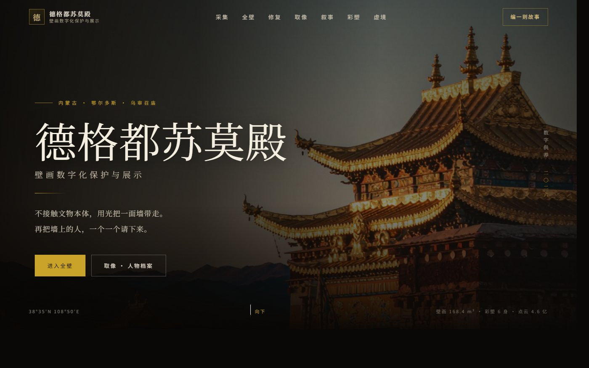
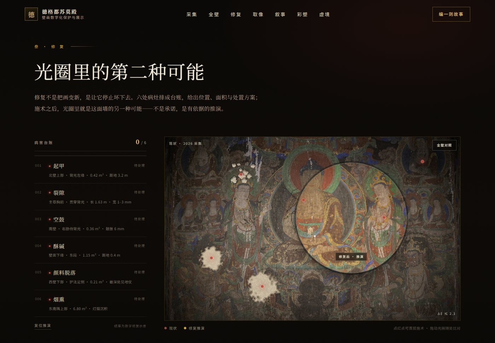
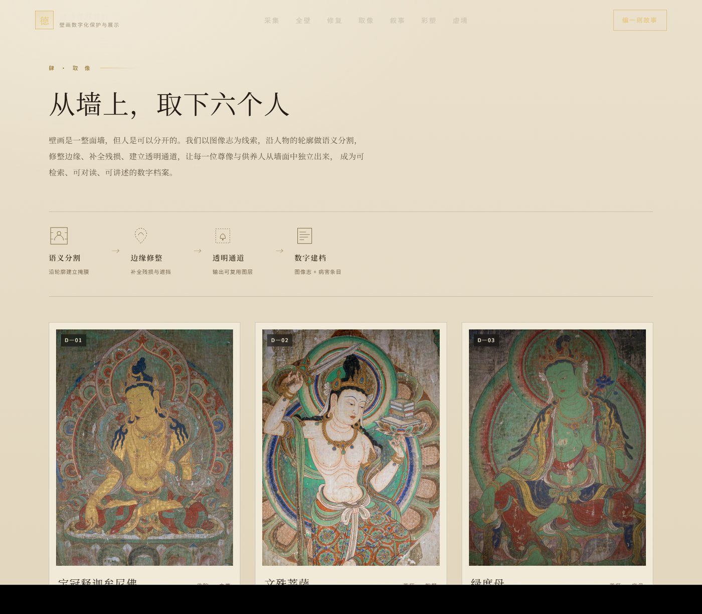

# 德格都苏莫殿 · 壁画数字供养

乌审召庙德格都苏莫殿「壁画数字化保护与展示」展陈原型：一个可以拖动看全壁、用光圈看修复推演、把壁画人物取下来单独建档、再替他们编一则故事的单页网站。

纯静态，无构建、无依赖，双击 `index.html` 即可打开。



## 七个章节

| 序号 | 章节 | 做什么 |
| --- | --- | --- |
| 壹 | 采集 | 非接触高保真采集、色彩校正、拼接、病害标注、三维扫描、VR 制作六道工序，配同图不同处理的可视化对照 |
| 贰 | 全壁 | 拖拽 / 缩放浏览 168.4 m² 壁画正射影像，点击光点进入人物档案 |
| 叁 | 修复 | **圆形光圈跟随指针，圈内即修复推演结果**；病害台账六条，点红点即可施术，逐处愈合，六处归位后自动切换全壁对照 |
| 肆 | 取像 | 从墙上「剥离」六位尊像与供养人，撕边图层 + 提取层 / 原壁色调 / 病害标注三种视图 |
| 伍 | 叙事 | 六个人物 × 四种视角（画师 / 香客 / 守庙人 / 风），打字机式生成故事 |
| 陆 | 彩塑 | 殿内六身彩塑三维扫描成果，实景 ↔ 点云切换 |
| 柒 | 虚境 | VR 节目《入殿》四章片花，网页端可直接放映 |





## 几个实现细节

- **光圈的严格配准**：`mural-now.jpg`（病害现状）由 `mural-panorama.jpg`（修复参考）程序化生成，两张图同尺寸、同裁切，只差色彩与病害层。光圈内层图按 `left = -(px - L/2)` 与舞台同尺寸对位，局部的「修复贴片」用 `background-size` / `background-position` 对齐，所以圈内外是同一个位置的两个版本，移动时不会跳。
- **撕边取像**：内联 SVG `clipPath`（`clipPathUnits="objectBoundingBox"`）+ 三条不规则路径，模拟从墙面剥离的一块壁画。
- **热区不随缩放变形**：全壁热区用 `--inv` 变量 + `scale: var(--inv)` 反向抵消画布缩放。
- **零依赖**：没有框架、没有 CDN、没有构建步骤；字体走系统宋体栈，无网也能正常显示。

## 目录结构

```
index.html              单页结构（七个章节 + 取像弹层 + VR 影院）
css/style.css           全部样式与响应式
js/data.js              内容数据：人物档案、故事、病害台账、工序、彩塑、交付清单
js/app.js               交互：全壁拖拽、光圈、施术、取像、故事生成、点云、VR
assets/img/             壁画、殿堂、六尊像、彩塑、病害现状图
assets/screenshots/     README 预览图
```

## 本地预览

```bash
# 方式一：直接双击 index.html
# 方式二：起一个静态服务器（推荐，路径更稳）
python -m http.server 8000
```

## 改内容

- **人物 / 故事 / 病害**：改 `js/data.js`，结构与注释都在里面，改文案不用动 HTML。
- **换真实图像**：把 `assets/img/` 下的同名文件替换掉即可。注意 `mural-panorama.jpg` 与 `mural-now.jpg` 必须**同尺寸同裁切**，否则光圈对比会错位。
- **换殿名与文案**：`index.html` 里直接搜索替换。

## 关于内容

- 页面中的壁画、彩塑、殿堂图像均为**风格示意与示意性重建**，不是真实文物影像；病害现状图由程序合成，用于演示对比交互。
- 人物故事是**基于图像志的文学演绎**，不是史料记载，不可作为文物资料引用。
- 「取像」与「修复推演」是展陈手法的演示，实际项目中的影像与三维数据须来自现场非接触采集，并随档案交付。

## License

代码与文案：MIT。  
图像仅用于本演示，请勿作为文物资料转载或引用。
